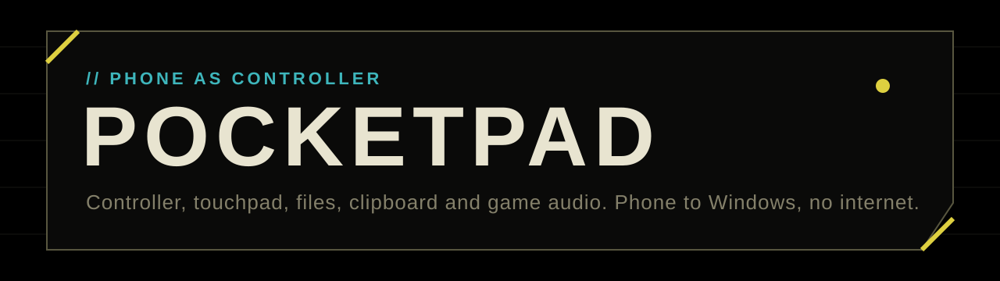

 

&nbsp;

[All releases](https://github.com/divakardznsyk/Pocketpad/releases) &nbsp;/&nbsp; Free &nbsp;/&nbsp; No account &nbsp;/&nbsp; No internet needed

---

## What it does

Pocketpad turns your Android phone into an Xbox controller for a Windows laptop, and adds the small things you
end up needing next to it. Everything runs over your own Wi-Fi, hotspot or USB cable.

| | |
|---|---|
| **Controller** | Shows up in Windows as an Xbox 360 pad, so RDR2, Elden Ring and anything else with controller support just works. Haptics, Xbox or PS5 look, one preset per game. |
| **Your layout** | Move, resize, remap, hide and fade every control. Change stick and touchpad speed while the game is running. The ping stays on screen. |
| **Touchpad** | A pad on the controller that moves the laptop mouse. Tap to click, tap with two fingers to right-click. |
| **Game audio** | Send the laptop's sound to the phone and use the earphones plugged into the phone. One button on, one button off. |
| **Files** | Drag a file onto the laptop window or tap Send on the phone. Both apps ask where to save each file, or save to a folder you pick. |
| **Clipboard** | A text box on each side that stays in sync live. Paste on one device, copy from the other. |

## Install

1. **Laptop:** download `Pocketpad-Setup.exe` above and run it. It installs the app, the controller driver
   (ViGEmBus) and the firewall rule in one go.
2. **Phone:** download `Pocketpad.apk`, open it, and allow installing from your browser or files app if asked.
3. Open Pocketpad on both. The phone finds the laptop by itself.

Windows or Play Protect may warn that the app is from an unknown publisher. That is normal for a free app that
is not code-signed. On Windows choose **More info**, then **Run anyway**. On Android choose **More details**, then
**Install anyway**. The full source is in this repository.

## Connect

Pick whichever you have. The phone app has all three under **Settings, Connection**.

| Mode | How | Typical delay |
|---|---|---|
| Hotspot or same Wi-Fi | Join the phone's hotspot from the laptop, or put both on one Wi-Fi | low |
| USB cable | Plug in, turn on USB tethering | lowest, and it charges the phone |
| Bluetooth | Pair, turn on Bluetooth tethering | highest |

## Play

Tap **Start playing**. The bar at the top shows the delay in milliseconds.

- **TUNE** changes left stick, right stick and touchpad speed live.
- **EDIT** lets you drag a control, then change its size, opacity, action, speed, or hide it.
- **X** goes back.

For the touchpad, open EDIT, tap the dashed TOUCHPAD box, move it where you want and switch it on.

### Audio to the phone

On the home screen tap **Laptop audio on this phone**. The laptop starts streaming whatever it plays and the phone
plays it through its speaker or earphones. Tap it again and the sound is back on the laptop.

- Expect around 100 to 200 ms of delay, fine for games but not for lip-sync in video.
- Under **Settings, Performance** you can have Pocketpad mute the laptop speakers while it streams. It puts the
  old state back afterwards.

## Uninstall

Close Pocketpad (the X really closes it) and uninstall it from Windows Settings. The uninstaller stops the app,
removes its files and settings, and asks whether to remove the controller driver too. On Android, uninstalling
removes the app and its data. Files you saved stay where you put them.

## How it works

- Controller: 14-byte UDP packets on port 39500 into a virtual Xbox 360 pad through ViGEmBus. Mouse, clipboard,
  audio and discovery use the same port.
- Files: the phone uploads to the laptop on TCP 39501; for laptop to phone, the laptop offers the file and the
  phone pulls it from TCP 39503.
- Audio: WASAPI loopback on the laptop, 16-bit stereo PCM over UDP, played with a low-latency AudioTrack.
- Android app is plain Kotlin with no libraries. The Windows app is C# on .NET 8 with NAudio and ViGEm.Client.

## Build it yourself

Pushing to `main` runs `.github/workflows/build.yml`, which builds the signed APK and the Windows installer and
publishes both as a release. Locally you need the Android SDK (`android/`) and the .NET 8 SDK plus Inno Setup
(`windows/`, `installer/`).

Made by Divakar

